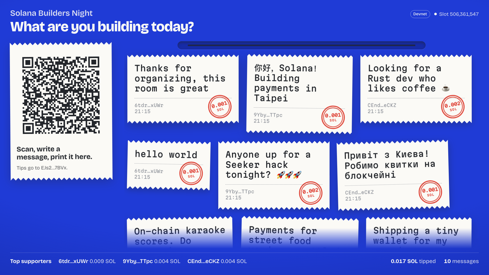
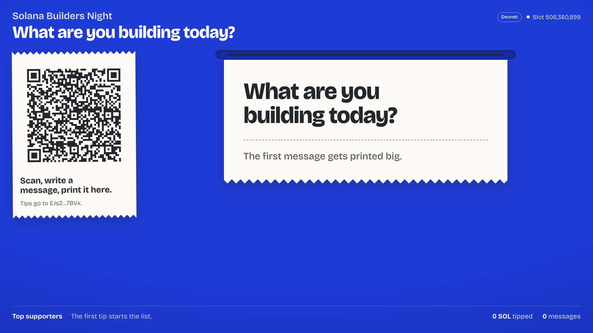
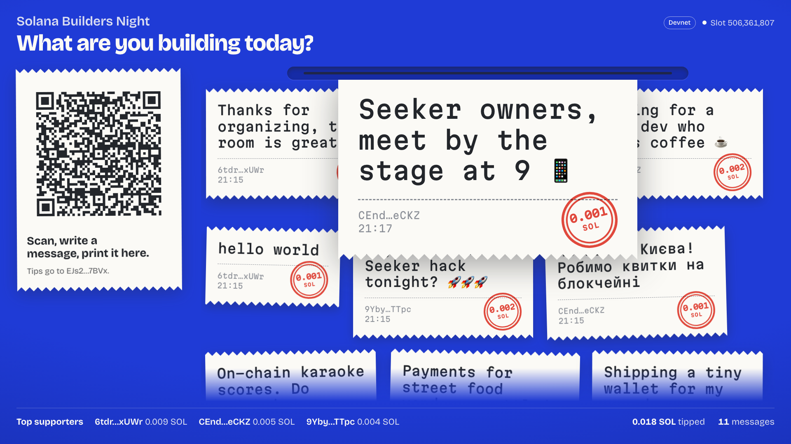
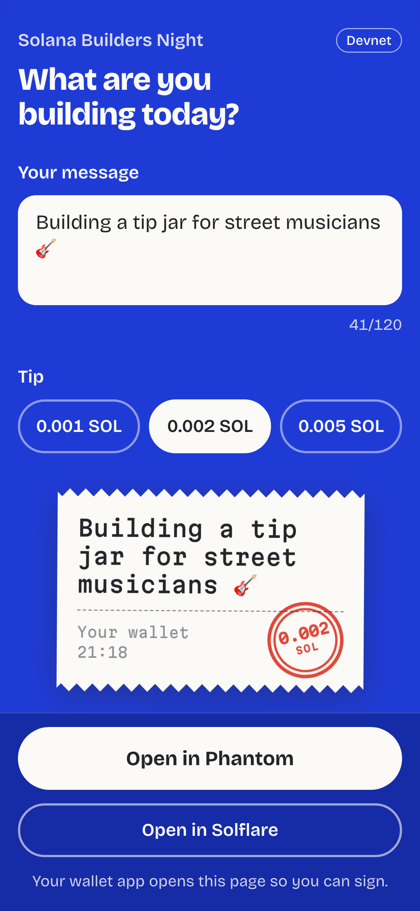
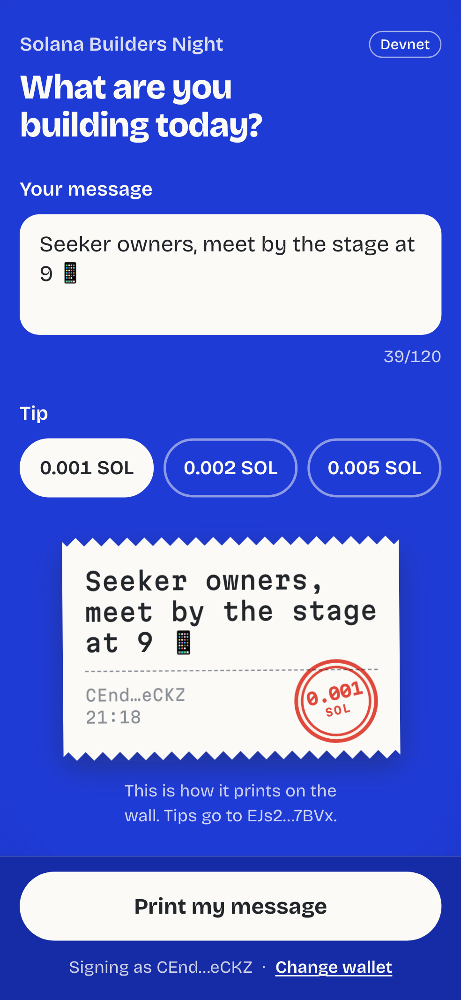
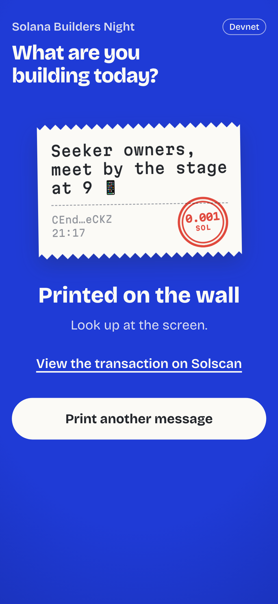

# Shoutout Wall

Live on-chain messages for events. The organizer puts the wall on the venue projector. Guests scan a QR code, write
a short message, attach a small SOL tip and sign one transaction. The message prints on the wall within seconds.

Everything lives on Solana. There is no backend, no database and no API routes: the site is a static export, the
guest transaction goes straight from the guest's wallet to the organizer, and the wall reads it back from chain.



## How it works

| Route | Who | What |
| --- | --- | --- |
| `/` | Organizer | Connect a wallet, set a title, a question for the room and a minimum tip, then "Start the wall". |
| `/wall?to=&ref=&t=&q=&min=` | Projector | The wall. All of its state is in the URL, so a refresh or another laptop shows the same wall. |
| `/send?to=&ref=&t=&q=&min=` | Guests | Where the QR code points. Write, pick a tip, print. |

"Start the wall" generates a random keypair and keeps only its public key as the wall's `ref`. Nothing is stored.

### The transaction

Built in the guest's browser and signed by the guest's wallet:

1. `ComputeBudget.setComputeUnitLimit(60_000)` and `setComputeUnitPrice(20_000 micro-lamports)` so it lands fast.
2. `SystemProgram.transfer(guest → organizer, lamports ≥ min)` with `ref` appended as a read-only, non-signer
   account (the Solana Pay "reference" pattern).
3. A memo (`MemoSq4gqABAXKb96qnH8TysNcWxMyWCqXgDLGmfcHr`) with UTF-8 data `sw1:` + message.

Messages are trimmed, whitespace is collapsed, control characters are stripped, and the limit is 120 characters.

**About the compute limit.** The Memo program writes the memo into its log, and that is not cheap for every
script. Measured on devnet: a 120 character ASCII message uses about 46k compute units, Cyrillic about 73k, and
emoji or CJK characters cost roughly 11k to 17k units *each*. So `60_000` is the limit for ordinary messages, and the
guest page raises it only when a simulation of the actual message says it needs more (never above the 1.4M
per-transaction maximum). A message too heavy for one transaction (around 75+ emoji) gets a clear error instead of
failing on chain. The extra priority fee is at most 0.000028 SOL.

### The wall

* On load: `getSignaturesForAddress(ref, { limit: 200 })` then `getParsedTransactions` so the history shows
  immediately.
* Then polling every 2.5 s with `until: newestKnownSignature`, plus `connection.onLogs(ref)` for instant updates when
  the RPC supports websockets. Polling always stays on as the fallback.
* A transaction counts only if it did not fail, has a system transfer to the organizer of at least `min`, and a memo
  starting with `sw1:`. The sender is the transfer source. Messages are deduped by signature and rendered as plain
  text, never HTML.
* New messages feed out of the printer slot line by line, stay big for about 4 seconds, then drop into the first
  position on the wall. Several at once are queued. With `prefers-reduced-motion` they simply fade in.
* At most 60 receipts stay in the page; older ones are only counted.

**Organizer controls** appear when you move the mouse:

* `F` or "Full screen".
* `P` or "Pause printing". New messages wait in a queue until you resume.
* Click a receipt, then "Hide from the wall". Hidden signatures are stored in this browser's localStorage. They stay
  on chain, and "Show hidden" brings them back.

## Environment variables

Copy `.env.example` to `.env` (or `.env.local`).

| Variable | Default | Notes |
| --- | --- | --- |
| `NEXT_PUBLIC_CLUSTER` | `mainnet-beta` | `mainnet-beta` or `devnet`. A small "Devnet" badge shows on devnet. |
| `NEXT_PUBLIC_RPC_URL` | public RPC of the cluster | Use a dedicated RPC such as [Helius](https://helius.dev). The public mainnet RPC rate-limits and will not keep up with a busy wall. |
| `NEXT_PUBLIC_WS_URL` | derived from the RPC URL | Only if your provider's websocket URL is different. |
| `NEXT_PUBLIC_SITE_URL` | the page's own origin | The origin the QR code points to. Set it if the wall runs on `localhost` but guests should open the deployed site. |

These are build-time values and end up in the JavaScript that browsers download, so the RPC key is public. Lock it
down in your RPC dashboard (for Helius: allowed domains) to the domain you deploy to.

## Run it locally

```bash
npm install
npm run dev
```

Open http://localhost:3000. `npm run build` writes the static site to `out/`, and `npm start` serves that folder.

Phones cannot reach `localhost`, so to test with a real phone either deploy (below) or set `NEXT_PUBLIC_SITE_URL` to
an address your phone can open, such as your laptop's LAN address or a tunnel.

## Test on devnet

1. Put `NEXT_PUBLIC_CLUSTER=devnet` in `.env`, plus a devnet RPC URL (for example
   `https://devnet.helius-rpc.com/?api-key=...`), and restart `npm run dev`.
2. Switch two wallets to devnet. Phantom: Settings → Developer settings → Testnet mode → Solana Devnet. Solflare:
   Settings → General → Network → Devnet.
3. Get devnet SOL for both wallets from https://faucet.solana.com, or with the Solana CLI:

   ```bash
   solana airdrop 1 <ADDRESS> --url devnet
   ```

4. Open `/` with the organizer wallet, start a wall and open it full screen.
5. From the second wallet, scan the QR (or open the `/send` link), write a message and print it. Repeat from the
   first wallet to see two supporters in the strip.

Without phones you can print from a local keypair. The script builds exactly the transaction the guest page builds
and refuses to run against anything but devnet:

```bash
npm run shout -- --wall "<wall URL>" --keypair ~/.config/solana/id.json "gm from devnet"
npm run shout -- --wall "<wall URL>" --keypair ./other.json --tip 5 "five times the minimum"
```

## Wallets

* Desktop and wallet in-app browsers: Wallet Standard wallets (Phantom, Solflare, Backpack and others) are detected
  automatically.
* Android: Mobile Wallet Adapter, in Chrome and on Seeker. The wallet app opens to sign and comes back.
* iOS, or any browser without a wallet: the guest page shows "Open in Phantom" and "Open in Solflare", which reopen the
  same page (with the message typed so far) inside the wallet's browser.

## Deploy

The site is plain static files, so any static host works.

**Vercel.** Import the repository. The Next.js preset is detected and the static export is used as is. Add the
environment variables in Project → Settings → Environment Variables and redeploy.

**Cloudflare Pages.** Create a project from the repository with:

* Framework preset: None (or Next.js (Static HTML Export))
* Build command: `npm run build`
* Build output directory: `out`
* Environment variables: the ones above, plus `NODE_VERSION=20` or newer

Or build locally and upload `out/` with `npx wrangler pages deploy out`.

## Screenshots

All taken from the production build on devnet. The messages are real devnet transactions sent from three test
wallets, one of them through the guest page itself.

| | |
| --- | --- |
| Empty wall |  |
| Wall with 10 messages |  |
| A message printing |  |

| Phone, no wallet (iOS) | Phone, wallet connected | Printed |
| --- | --- | --- |
|  |  |  |

## Project layout

```
app/
  (wallet)/page.tsx        organizer setup         components/setup/SetupScreen.tsx
  (wallet)/send/page.tsx   guest page              components/send/SendScreen.tsx
  wall/page.tsx            projector wall          components/wall/*
components/Receipt.tsx     the printed receipt, used on the wall and as the guest preview
lib/protocol.ts            message rules, transaction instructions, parsing transactions back
lib/print.ts               simulation-sized transaction and guest-facing errors
lib/wall-link.ts           wall parameters in the URL
scripts/devnet-shout.ts    print from a local keypair on devnet
```
